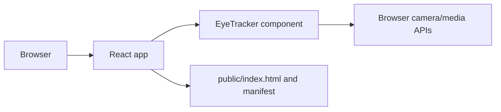

# Majen Eye

A React 18 single-page application for browser-based eye tracking. The UI mounts an `EyeTracker` component and renders the tracking experience from the client without a server-side API.

## Architecture



`src/index.js` bootstraps the React tree; `src/App.js` composes the tracker; CSS and static assets live under `src/` and `public/`.

## Local development

```bash
npm ci
npm start
# production bundle
npm run build
# interactive test runner
npm test
```

The development server serves the app on the Create React App default port (usually `3000`). Camera access requires a secure origin (`localhost` is allowed by browsers) and explicit user permission.

## Data flow and configuration

Tracking data is produced in the browser by the `EyeTracker` component. No backend persistence or documented external API is present in this repository. The web manifest and `public/` assets define installable/PWA metadata.

## Deployment

Deploy the generated `build/` directory to a static host such as GitHub Pages, Netlify, or an object-storage/CDN origin. Configure the host with HTTPS and the correct SPA fallback so client routes resolve to `index.html`.

## Limitations

Accuracy depends on camera quality, lighting, calibration, browser permissions, and the implementation of the tracker component. There is no repository-level telemetry, calibration-data persistence, or automated end-to-end coverage.

## Security and operations

- Keep credentials, database URLs, OAuth tokens, API keys, and signing secrets in environment variables; never commit them.
- Validate and constrain uploaded files and user input at the server boundary, and enable HTTPS in production.
- Review dependency updates and rotate any credential that has appeared in repository history.

## Testing

The repository currently has no comprehensive automated test suite unless noted above. Before production changes, add tests for authentication/authorization, validation failures, persistence errors, and the primary user workflow.

## Limitations and roadmap

This is an actively evolving project. Production hardening, observability, rate limiting, backup/retention policy, and accessibility/performance validation should be completed before handling sensitive or high-volume workloads.

## License

See the repository license file and package metadata for the authoritative terms.
